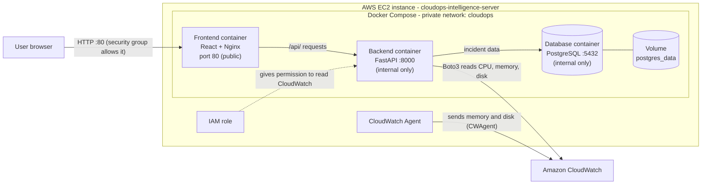

# CloudOps Nexus

CloudOps Nexus is a cloud operations dashboard. It shows the CPU, memory and disk usage of an EC2 instance, and lets you create and view incidents, all in one place.

- Frontend: React (built with Vite), served by Nginx
- Backend: Python + FastAPI
- Database: PostgreSQL (stores the incidents)
- Metrics: AWS CloudWatch
- Run with: Docker and Docker Compose
- Deploy with: GitHub Actions on a self-hosted runner
- Host: one AWS EC2 instance

## Architecture

Everything runs on one EC2 instance. Docker Compose starts three containers on it: frontend, backend and database. The same instance also hosts the GitHub Actions runner, and it is the instance being monitored.

I split this into two diagrams, because runtime traffic and deployment are not the same flow.

### 1. Runtime (what happens when someone uses the app)


Notes on this diagram:

- Only port 80 is open to the internet. Ports 8000 and 5432 stay inside the Docker network.
- CPU comes from the `AWS/EC2` namespace. EC2 sends it to CloudWatch by itself.
- Memory and disk come from the `CWAgent` namespace. The CloudWatch Agent on the instance sends them.
- The backend only reads the metrics. It uses the IAM role on the instance, so no AWS keys are inside the app.
- The React app never talks to PostgreSQL or CloudWatch directly. It only calls the backend through `/api/`.

### 2. Deployment (what happens when I push code)

```mermaid
flowchart LR
    Push["Push to main<br/>(or manual run)"] -.-> Runner["GitHub Actions<br/>self-hosted runner on EC2"]
    Runner -.-> S1["Checkout code"]
    S1 -.-> S2["Backend syntax check"]
    S2 -.-> S3["Frontend build<br/>(npm ci + Vite)"]
    S3 -.-> S4["Copy .env from EC2<br/>and check variables"]
    S4 -.-> S5["docker-compose config -q"]
    S5 -.-> S6["docker-compose up -d<br/>--build --remove-orphans"]
    S6 -.-> S7["docker-compose ps"]
```


The dashed lines mean deployment steps, not user traffic.

## How a request works

1. The user opens the EC2 public IP in a browser.
2. The request comes in on port 80 and reaches the frontend container.
3. Nginx serves the React app.
4. React asks for data through `/api/`.
5. Nginx passes that request to FastAPI inside the Docker network.
6. FastAPI gets the metrics from CloudWatch and the incidents from PostgreSQL.
7. FastAPI sends the response back and React shows it on the dashboard.

To create an incident, React sends a POST request. FastAPI saves it in PostgreSQL and returns the new record.

## What the dashboard has

- CPU utilization (`AWS/EC2`)
- Memory and disk utilization (`CWAgent`)
- Create and list incidents (PostgreSQL)
- Light and dark theme

Not included in this version: Cost Explorer, login, editing or deleting incidents, and notifications.

## API routes

Nginx sends everything under `/api` to the backend.

| Method | Route | Purpose |
| --- | --- | --- |
| GET | `/api/health` | Check the backend is up |
| GET | `/api/monitoring` | Get CPU, memory and disk metrics |
| GET | `/api/incidents` | List incidents |
| POST | `/api/incidents` | Create an incident |

## Deployment details

| Item | Value |
| --- | --- |
| EC2 instance name | `cloudops-intelligence-server` |
| Instance ID | `i-01d84b19a86a4b42d` |
| Region | `us-east-1` |
| OS | Amazon Linux 2023 |
| Public port | TCP 80 (frontend / Nginx) |
| Runner | `cloudops-ec2-runner` (self-hosted) |

The workflow updates this existing server. It does not create a new one.

**EC2 setup that was done:**

- Installed Docker and Docker Compose
- Attached the IAM role for CloudWatch access
- Installed the CloudWatch Agent for memory and disk metrics
- Set up the GitHub Actions self-hosted runner
- Created the private `.env` file at `/home/ec2-user/cloudops-backend/.env`

**The `.env` file** has the database settings, the AWS region, the EC2 instance ID and the CloudWatch Agent disk settings. It stays on the EC2 server and is never committed to GitHub. The workflow copies it into the workspace during deployment.

**Security group:**

- Allow inbound HTTP 80 so the website can open
- Keep SSH 22 only for trusted IP addresses
- Do not open ports 8000 or 5432 to the internet

**Things to remember:**

- The backend runs inside a container, so if CloudWatch gives credential errors, check that the instance metadata hop limit is set to 2.
- The public IP changes after a stop and start. Use an Elastic IP if you want it fixed.
- The runner is on the same server as the app, so only trusted code should trigger it.

## Current status

GitHub Actions Run #8 passed. The frontend, backend and database containers are running, the database is healthy, and port `80:80` is published.

**Known issue:** the browser test to the EC2 public IP timed out. So the pipeline works, but opening the site from the internet is not confirmed yet. Check the security group rule for port 80, the public IP, and use `http://` (not `https://`). Also run `curl http://localhost` on the server. Remove this note once the site opens.

## Docker Compose

`docker-compose.yml` has three services:

- `database` uses `postgres:16-alpine`, has a `pg_isready` health check, and saves data in `postgres_data`
- `backend` is built from `backend/` and waits until the database is healthy
- `frontend` is built from `frontend/`, publishes port 80, and passes `/api/` to the backend

All three run on the private `cloudops` network.

### Run locally
```bash
cp .env.example .env
# fill in the values in .env
docker compose up -d --build
```

### Run on EC2

The EC2 server uses the older `docker-compose` command, and the workflow runs:
```bash
docker-compose config -q
docker-compose up -d --build --remove-orphans
docker-compose ps
```

### Check and stop

Use `docker compose` locally or `docker-compose` on EC2:
```bash
docker compose ps
docker compose logs -f
docker compose down
```

`down` removes the containers and network but keeps the `postgres_data` volume. Do not add `-v` unless you really want to delete all the incidents.

Never commit the real `.env` file or share its password in screenshots or logs.

## Project structure
```text
backend/                 FastAPI code, models, backend Dockerfile
frontend/                React app, nginx.conf, frontend Dockerfile
.github/workflows/       deploy.yml (GitHub Actions)
docker-compose.yml       frontend, backend and database services
.env.example             names of the required settings
docs/                    project documentation
```
