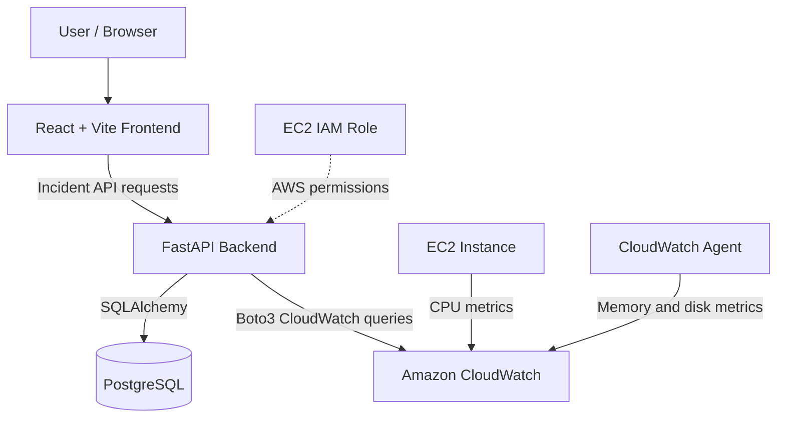

# CloudOps Nexus

### AWS Cloud Infrastructure Monitoring & Incident Management Platform

CloudOps Nexus is a cloud operations dashboard built with React, FastAPI, and PostgreSQL. The application includes incident management and a backend API for retrieving EC2 monitoring metrics from Amazon CloudWatch.

## Project Overview

The project brings dashboard navigation, incident record management, and AWS monitoring functionality into one application.

## Technology Stack

| Area | Technology | Purpose |
|---|---|---|
| Frontend | React, Vite, CSS | Dashboard interface |
| Backend | Python, FastAPI | REST API |
| Database | PostgreSQL | Incident storage |
| ORM | SQLAlchemy | Database operations |
| AWS SDK | Boto3 | CloudWatch API calls |
| Monitoring | Amazon CloudWatch, CloudWatch Agent | EC2 and operating-system metrics |
| Compute | Amazon EC2 | Backend host in the demonstration environment |
| Version Control | Git, GitHub | Source control |

## Current Implementation

- React dashboard layout with navigation and light/dark theme toggle.
- FastAPI home and health endpoints.
- Incident creation and listing using PostgreSQL and SQLAlchemy.
- Backend `GET /monitoring` endpoint for CloudWatch CPU, memory, and disk metrics.
- EC2 monitoring configuration using an IAM role and CloudWatch Agent.

## Current Frontend Scope

The React incident page and dashboard incident count connect to the FastAPI incident endpoints. The monitoring and cost pages are currently interface placeholders. The dashboard CPU, memory, and disk cards also display placeholder values; the React frontend does not yet call the backend `/monitoring` endpoint.

The backend monitoring endpoint is implemented separately and can be tested through the FastAPI API when the AWS monitoring environment is available.

## Planned Improvements

- Connect the React monitoring page and dashboard metric cards to `GET /monitoring`.
- Configure the frontend API base URL for different environments.
- Implement AWS Cost Explorer reporting.
- Implement SNS notifications.
- Add incident update and resolution operations.
- Containerize the full application with Docker Compose.
- Add automated tests and a GitHub Actions CI/CD pipeline.
- Configure persistent process supervision and production deployment.

## Architecture



The CloudWatch integration is available through the backend API. Connecting those metric responses to the React monitoring screens remains a planned frontend improvement.

## API Endpoints

| Method | Endpoint | Purpose |
|---|---|---|
| GET | `/` | Basic application response |
| GET | `/health` | Health status |
| GET | `/monitoring` | Retrieve CloudWatch CPU, memory, and disk metrics |
| POST | `/incidents` | Create an incident |
| GET | `/incidents` | List incidents |

## Repository Structure

```text
CloudOps-Nexus/
├── backend/
│   ├── main.py
│   ├── database.py
│   └── models.py
├── frontend/
│   ├── src/
│   ├── public/
│   ├── package.json
│   └── vite.config.js
├── docs/
│   ├── architecture.md
│   ├── workflow.md
│   ├── aws-services.md
│   └── docker-and-cicd.md
└── README.md
```

## Local Development

### Requirements
- Python and pip
- Node.js and npm
- PostgreSQL
- AWS monitoring permissions for the CloudWatch endpoint

### Backend

From the `backend` directory, install the Python packages used by the application and start FastAPI:

```bash
python -m uvicorn main:app --reload
```

FastAPI's interactive API documentation is available at `http://127.0.0.1:8000/docs`.

### Frontend

From the `frontend` directory:

```bash
npm install
npm run dev
```

The current frontend incident requests use `http://127.0.0.1:8000`. The API must be running at that address for incident creation and listing to work.

## Documentation

- [System Architecture](docs/architecture.md)
- [Application Workflow](docs/workflow.md)
- [AWS Services](docs/aws-services.md)
- [Docker and GitHub Actions](docs/docker-and-cicd.md)

## Project Status

The repository contains the React interface, incident API/database code, and a backend CloudWatch metric retrieval endpoint. The frontend monitoring and cost screens are not yet connected to live data. Full application Docker Compose, GitHub Actions CI/CD, SNS notifications, and Cost Explorer reporting are not implemented.

## Author

B.Tech – Computer Science and Engineering (Data Science)

AWS Cloud & DevOps Project

---

**Repository:** https://github.com/Bharath9542530187/CloudOps-Nexus
