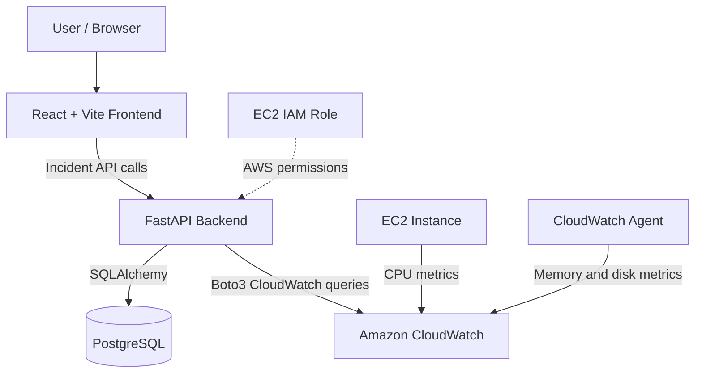

# CloudOps Nexus

### AWS Cloud Infrastructure Monitoring & Incident Management Platform

CloudOps Nexus is a cloud operations dashboard built with React, FastAPI, and PostgreSQL. Its backend includes incident-management endpoints and an AWS CloudWatch monitoring endpoint for EC2 CPU, memory, and disk metrics.

## Project Overview

The project brings a dashboard interface, incident record management, and AWS monitoring API functionality into one application structure.

## Technology Stack

| Area | Technology | Purpose |
|---|---|---|
| Frontend | React, Vite, CSS | Dashboard interface |
| Backend | Python, FastAPI | REST API |
| Database | PostgreSQL | Incident storage |
| ORM | SQLAlchemy | Database operations |
| AWS SDK | Boto3 | CloudWatch API calls |
| Monitoring | Amazon CloudWatch, CloudWatch Agent | EC2 and operating-system metrics |
| Compute | Amazon EC2 | Demonstrated backend host |
| Version control | Git, GitHub | Source control |

## Current Implementation

- React dashboard layout with navigation and light/dark theme toggle.
- FastAPI home and health endpoints.
- Incident creation and listing endpoints using PostgreSQL and SQLAlchemy.
- A backend `GET /monitoring` endpoint that queries CloudWatch for CPU, memory, and disk metrics.
- EC2 monitoring configuration using an IAM role and CloudWatch Agent in the demonstrated AWS environment.

## Current Frontend Scope

The current React source connects the incident page and dashboard incident count to `http://127.0.0.1:8000/incidents`. The monitoring and cost pages are currently interface placeholders. The dashboard's CPU, memory, and disk cards also display placeholder values; the React source does not yet call the backend `/monitoring` endpoint.

The backend monitoring endpoint is implemented separately and can be tested through the FastAPI API, subject to valid AWS credentials/role permissions and matching CloudWatch metric dimensions.

## Planned Improvements

- Connect the React monitoring page and dashboard metric cards to `GET /monitoring`.
- Configure the frontend API base URL through environment configuration instead of hardcoding localhost.
- Implement AWS Cost Explorer reporting.
- Implement SNS notifications.
- Add incident update and resolution operations.
- Containerize the full application with Docker Compose.
- Add automated tests and a GitHub Actions CI/CD pipeline.
- Configure persistent process supervision and production deployment security.

## Architecture



The CloudWatch path exists in the backend API. Connecting those metric responses to the React monitoring screens remains a planned frontend integration.

## API Endpoints

| Method | Endpoint | Purpose |
|---|---|---|
| GET | `/` | Basic application response |
| GET | `/health` | Health status |
| GET | `/monitoring` | Retrieve CloudWatch CPU, memory, and disk metrics |
| POST | `/incidents` | Create an incident |
| GET | `/incidents` | List incidents |

## Repository Structure

```text
CloudOps-Nexus/
├── backend/
│   ├── main.py
│   ├── database.py
│   └── models.py
├── frontend/
│   ├── src/
│   ├── public/
│   ├── package.json
│   └── vite.config.js
├── docs/
│   ├── architecture.md
│   ├── workflow.md
│   ├── aws-services.md
│   ├── docker-and-cicd.md
│   ├── interview-preparation.md
│   └── screenshots/
├── .env.example
├── .gitignore
└── README.md
```

## Local Development

### Prerequisites
- Python and pip.
- Node.js and npm.
- PostgreSQL.
- AWS credentials or an EC2 IAM role with the CloudWatch read permissions required by the monitoring endpoint.

### Backend

The backend imports FastAPI, SQLAlchemy, python-dotenv, Boto3, and Botocore. Install the corresponding Python packages in your environment, configure `DATABASE_URL` in a local `.env` file, then run from the `backend` directory:

```bash
python -m uvicorn main:app --reload
```

FastAPI's interactive API documentation is available at `http://127.0.0.1:8000/docs`.

### Frontend

Run from the `frontend` directory:

```bash
npm install
npm run dev
```

The current frontend incident requests use `http://127.0.0.1:8000`. The API must be running at that address for incident creation and listing to work.

## Documentation

- [System Architecture](docs/architecture.md)
- [Application Workflow](docs/workflow.md)
- [AWS Services](docs/aws-services.md)
- [Docker and GitHub Actions – Future Design](docs/docker-and-cicd.md)
- [Interview Preparation](docs/interview-preparation.md)
- [Application Screenshots](docs/screenshots/README.md)

## Security and Deployment Notes

- Do not commit `.env`, AWS access keys, private keys, or database passwords.
- Use an EC2 IAM role instead of hardcoding AWS credentials.
- Restrict security group rules to required sources and ports.
- The current backend source contains a fixed AWS region and EC2 instance identifier. These should be moved into environment configuration before reuse.
- The current frontend uses a localhost API URL; configure a deployment-specific API base URL before hosting the frontend separately.
- The demonstration API process was started manually. Persistent process supervision, HTTPS, and high availability are not configured.

## Project Status

The repository contains the React interface, incident API/database code, and a backend CloudWatch metric retrieval endpoint. The frontend monitoring and cost screens are not yet connected to live data. Docker Compose for the full application, GitHub Actions CI/CD, SNS notifications, and Cost Explorer reporting are not implemented.

## Author

B.Tech – Computer Science and Engineering (Data Science)

AWS Cloud & DevOps Project

---

**Repository:** https://github.com/Bharath9542530187/CloudOps-Nexus
