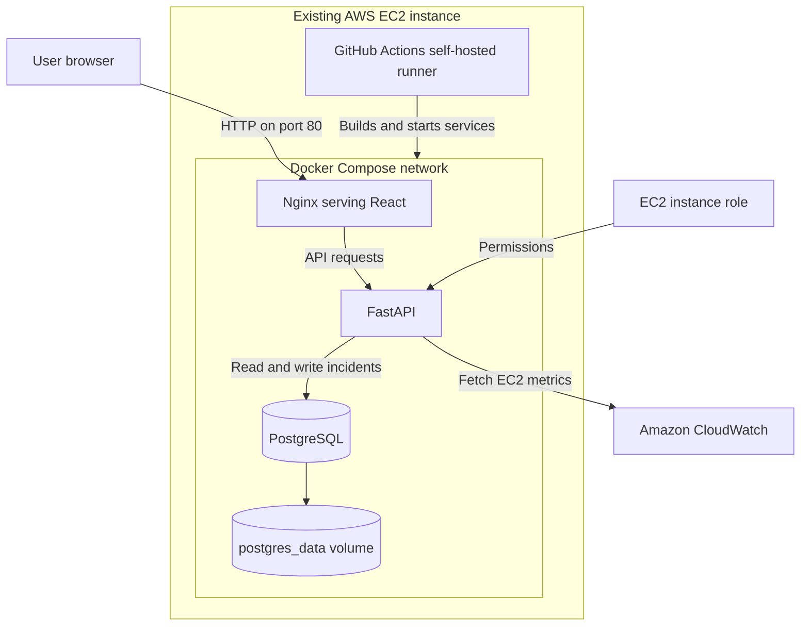

# CloudOps Nexus

CloudOps Nexus is a small AWS operations dashboard built to bring EC2 monitoring and incident tracking into one place. The web interface is built with React, the API uses FastAPI, and PostgreSQL keeps the incident records. AWS CloudWatch supplies the instance metrics shown by the dashboard.

## Architecture

The deployed version uses one Amazon EC2 instance. The application is split into three Docker containers so each service has its own runtime.



- **React and Nginx:** Nginx serves the built frontend on port 80. Requests beginning with `/api/` are forwarded to FastAPI.
- **FastAPI:** Handles the dashboard's API requests, creates and lists incidents, and requests CPU, memory, and disk metrics from CloudWatch.
- **PostgreSQL:** Stores incident data. Its files live in the `postgres_data` Docker volume, so recreating containers does not remove the database.
- **Docker Compose:** Connects the three services on the `cloudops` bridge network. The backend reaches PostgreSQL by its Compose service name, `database`.
- **EC2 IAM role:** Gives the backend access to the CloudWatch metrics it needs without placing AWS access keys in the application configuration.

Only the frontend publishes a host port (`80:80`). The backend's port 8000 and PostgreSQL's port 5432 are available to the other containers on the private Docker network, not published as host ports.

## What the dashboard includes

- EC2 CPU utilization from the `AWS/EC2` CloudWatch namespace.
- Memory and disk utilization from the `CWAgent` namespace.
- Incident creation and incident listing backed by PostgreSQL.
- Light and dark dashboard themes.

This version does not include Cost Explorer reporting, user authentication, incident editing or deletion, or notification delivery.

## Technology used

| Part | Implementation |
|---|---|
| Web interface | React and Vite |
| Web server / reverse proxy | Nginx |
| API | Python and FastAPI |
| AWS metrics | Boto3 and Amazon CloudWatch |
| Database | PostgreSQL and SQLAlchemy |
| Packaging and runtime | Docker and Docker Compose |
| Hosting | Amazon EC2 (Amazon Linux 2023) |
| Automation | GitHub Actions with a self-hosted EC2 runner |

## AWS deployment

CloudOps Nexus is deployed to the existing EC2 instance below. The workflow updates this server; it does not provision a replacement instance.

| Detail | Value |
|---|---|
| EC2 instance name | `cloudops-intelligence-server` |
| Instance ID | `i-01d84b19a86a4b42d` |
| AWS Region | `us-east-1` (N. Virginia) |
| Operating system | Amazon Linux 2023 |
| Public-facing container | Frontend / Nginx |
| Published port | TCP 80 |
| Deployment runner | `cloudops-ec2-runner` (self-hosted) |

The GitHub Actions runner is installed on the EC2 host. On a push to `main`, the workflow checks out the new revision in the runner workspace, checks the backend Python syntax, builds the Vite frontend, and validates the Compose configuration. It then copies the server-side environment file from `/home/ec2-user/cloudops-backend/.env` into the workflow workspace and starts the updated services with Docker Compose.

The environment file contains the database configuration and the AWS region, EC2 instance ID, and CloudWatch Agent disk dimensions used by the monitoring endpoint. It stays on the EC2 host and is not stored in the repository. The EC2 instance role is used for AWS API access.

For browser access, the EC2 security group needs an inbound HTTP rule for TCP port 80. SSH (TCP 22) should remain limited to trusted administrator addresses. Do not expose ports 8000 or 5432 to the public internet. A successful CI/CD run confirms that the deployment commands and containers completed; it does not by itself confirm that the website is reachable from every browser or network.

## Docker Compose

The Compose file defines the three services and their relationship:

- `database` uses `postgres:16-alpine`, checks readiness with `pg_isready`, and stores data in `postgres_data`.
- `backend` is built from `backend/` and starts after the database reports healthy.
- `frontend` is built from `frontend/`, serves on host port 80, and sends API traffic through Nginx to the backend.

The application reads its configuration from environment variables. The tracked `.env.example` shows the required names; use real values only in a private `.env` file. Never commit that private file or put its password in an issue, screenshot, or log.

### Start the stack

For a local machine with the Docker Compose v2 plugin, use:

```bash
cp .env.example .env
# Set the values in .env before starting the services.
docker compose up -d --build
```

The EC2 runner currently uses the standalone `docker-compose` command. Its deployment workflow runs:

```bash
docker-compose config -q
docker-compose up -d --build --remove-orphans
docker-compose ps
```

### Check and stop services

Use the Compose command installed on the machine:

```bash
docker compose ps
docker compose logs -f
docker compose down
```

On the EC2 host, the equivalent command name is `docker-compose`:

```bash
docker-compose ps
docker-compose logs -f
docker-compose down
```

The normal `down` command removes the containers and network but leaves the `postgres_data` volume intact. Removing that volume would also remove the stored incident records, so do not add the `-v` option unless deleting the database is intentional.

## API routes

Nginx exposes these backend routes under `/api`:

| Method | Route | Use |
|---|---|---|
| GET | `/api/health` | Check that the API responds |
| GET | `/api/monitoring` | Retrieve CPU, memory, and disk metrics |
| GET | `/api/incidents` | List saved incidents |
| POST | `/api/incidents` | Create an incident |

## Repository layout

```text
backend/                 FastAPI code, database models, and backend Dockerfile
frontend/                React app, Nginx configuration, and frontend Dockerfile
.github/workflows/       GitHub Actions deployment workflow
docker-compose.yml       Frontend, backend, and database services
.env.example             Names and example values for required configuration
docs/                    Project documentation
```
