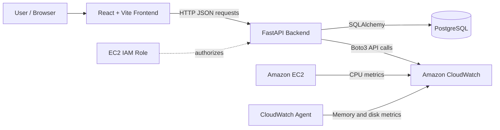

# CloudOps Nexus

### AWS Cloud Infrastructure Monitoring & Incident Management Platform

CloudOps Nexus is a web-based cloud operations dashboard that brings AWS infrastructure visibility and incident tracking into one interface. It combines a React frontend, a Python FastAPI backend, PostgreSQL storage, and Amazon CloudWatch metrics.

> **Project scope:** This repository contains the application source code and documentation for the current working demonstration. Features marked as planned are design extensions and are not presented as completed integrations.

## Overview

CloudOps Nexus provides a central interface for:
- Viewing infrastructure monitoring information.
- Retrieving EC2 CPU, memory, and disk utilization metrics from Amazon CloudWatch.
- Creating and listing operational incidents.
- Storing incident records in PostgreSQL.
- Viewing information through a React dashboard with a dark interface.

## Architecture



See [Architecture](docs/architecture.md) and [Application Workflow](docs/workflow.md) for the detailed explanation.

## Technology Stack

| Area | Technology | Purpose |
|---|---|---|
| Frontend | React, Vite, CSS | Dashboard and user interface |
| Backend | Python, FastAPI | REST API and application logic |
| Database | PostgreSQL | Incident data storage |
| ORM | SQLAlchemy | Database models and queries |
| AWS SDK | Boto3 | Read CloudWatch metrics |
| Monitoring | Amazon CloudWatch, CloudWatch Agent | CPU, memory, and disk metrics |
| Compute | Amazon EC2 | Hosts the API in the demonstration setup |
| Version control | Git, GitHub | Source code and project history |

## Implemented in the current project

- React-based dashboard and dark interface.
- FastAPI application with health and monitoring endpoints.
- Incident creation through `POST /incidents`.
- Incident listing through `GET /incidents`.
- PostgreSQL incident model and SQLAlchemy database integration.
- Monitoring endpoint that queries CloudWatch for EC2 CPU, memory, and disk utilization.
- EC2 monitoring setup with an IAM role and CloudWatch Agent for memory and disk metrics.

## Planned extensions

These are documented as future improvements and are **not claimed as implemented**:
- Docker packaging of the application services and Docker Compose orchestration.
- GitHub Actions automated testing/build/deployment pipeline.
- SNS-based email notifications for incidents or metric thresholds.
- AWS Cost Explorer integration for cost reporting.
- Production-grade deployment automation and service supervision.
- Expanded incident lifecycle operations (for example, update, assign, resolve).

## Repository structure

```text
CloudOps-Nexus/
├── backend/
│   ├── main.py
│   ├── database.py
│   └── models.py
├── frontend/
│   ├── src/
│   ├── public/
│   ├── package.json
│   └── vite.config.js
├── docs/
│   ├── architecture.md
│   ├── workflow.md
│   ├── aws-services.md
│   ├── docker-and-cicd.md
│   ├── interview-preparation.md
│   └── screenshots/
├── .env.example
├── .gitignore
└── README.md
```

## Run locally

### Prerequisites
- Python 3.10+ (use a version compatible with the installed backend dependencies).
- Node.js and npm.
- PostgreSQL.
- AWS credentials or an attached EC2 IAM role with permission to read the required CloudWatch metrics, when testing monitoring.

### Backend
1. Create a PostgreSQL database.
2. Configure `DATABASE_URL` in a local `.env` file using the format in `.env.example`.
3. Install the backend dependencies required by the project.
4. From the backend directory, start the FastAPI application:

```bash
python -m uvicorn main:app --reload
```

The API documentation is available at `http://127.0.0.1:8000/docs` while the backend is running.

### Frontend
From the frontend directory:

```bash
npm install
npm run dev
```

Open the local URL printed by Vite in the terminal. Configure the frontend API base URL to point to the running FastAPI backend if the application configuration requires it.

> The repository's current backend source expects a configured database URL. CloudWatch monitoring also requires valid AWS access and the configured region/instance dimensions. Local startup alone does not guarantee that AWS metrics will be available.

## API endpoints

| Method | Endpoint | Purpose |
|---|---|---|
| GET | `/` | Basic application response |
| GET | `/health` | Health status |
| GET | `/monitoring` | Retrieve CloudWatch CPU, memory, and disk metrics |
| POST | `/incidents` | Create an incident |
| GET | `/incidents` | List incidents |

## Documentation

- [System Architecture](docs/architecture.md)
- [Application Workflow](docs/workflow.md)
- [AWS Services and Monitoring](docs/aws-services.md)
- [Docker and CI/CD – Future Design](docs/docker-and-cicd.md)
- [Interview Preparation](docs/interview-preparation.md)
- [Dashboard Screenshots](docs/screenshots/README.md)

## Security notes

- Never commit `.env`, AWS access keys, private keys, database passwords, or other secrets.
- Use an EC2 IAM role instead of hardcoding AWS credentials on EC2.
- Restrict inbound network rules to the minimum required sources.
- Replace demonstration-specific AWS resource identifiers with configuration/environment variables before reusing the project in another account.
- The current source contains an EC2 instance identifier and a fixed AWS region for its monitoring query; treat these as deployment configuration to externalize before production use.

## Project status and limitations

The repository includes the frontend and backend source, incident API/database code, and CloudWatch metric retrieval logic. The demonstrated monitoring setup uses EC2, IAM permissions, and the CloudWatch Agent. The API process in the demonstration was started manually; automatic process supervision, high availability, and production deployment automation are not included.

SNS notifications, Cost Explorer, Docker Compose for the full application, and GitHub Actions CI/CD are future enhancements. Dashboard screenshots should be added to `docs/screenshots/` after capturing them from the actual running application.

## Author

B.Tech – Computer Science and Engineering (Data Science)

AWS Cloud & DevOps Project

---

**Repository:** https://github.com/Bharath9542530187/CloudOps-Nexus
