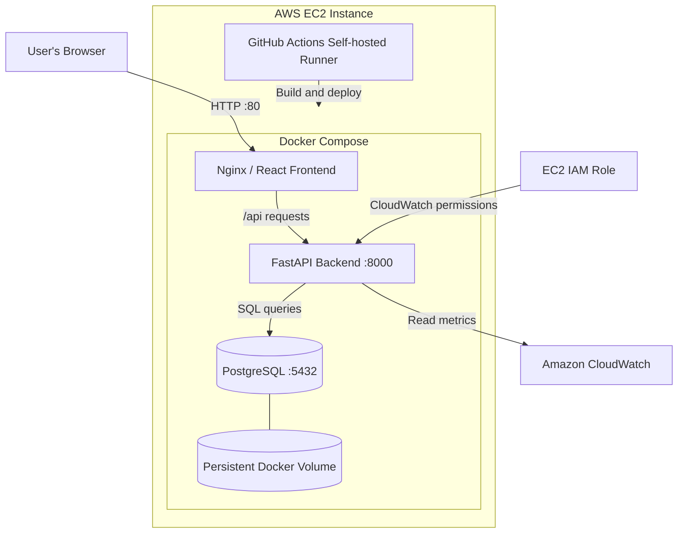

# CloudOps Nexus

CloudOps Nexus is a cloud operations dashboard built with React, FastAPI, and PostgreSQL. It displays EC2 CPU, memory, and disk metrics collected through Amazon CloudWatch and supports basic incident management.

## Project Architecture

The application runs on one existing AWS EC2 instance. Docker Compose manages three containers: the React frontend served by Nginx, the FastAPI backend, and PostgreSQL.



### Component responsibilities

- **Frontend:** React production build served by Nginx on port 80.
- **Backend:** FastAPI handles API requests, incident records, and CloudWatch metric queries.
- **Database:** PostgreSQL stores incident records in a persistent named Docker volume.
- **Nginx:** Serves the frontend and forwards `/api/` requests to the backend.
- **Docker Compose:** Starts and connects the three application services on a private Docker bridge network.
- **GitHub Actions:** Runs checks and deploys the application using a self-hosted runner on EC2.

The browser reaches Nginx through port 80. The backend and database communicate over the Docker network; their ports are not published directly to the internet. The backend accesses CloudWatch using the EC2 instance IAM role.

## Technology Stack

| Area | Technology |
|---|---|
| Frontend | React, Vite, Nginx |
| Backend | Python, FastAPI, Boto3 |
| Database | PostgreSQL, SQLAlchemy |
| Containers | Docker, Docker Compose |
| Cloud | AWS EC2, IAM, CloudWatch, CloudWatch Agent |
| CI/CD | GitHub Actions, self-hosted runner |
| Source control | Git, GitHub |

## Application Features

- Dashboard with CPU, memory, disk, and incident information.
- Create and list incidents stored in PostgreSQL.
- Monitoring page reads metrics from the FastAPI CloudWatch endpoint.
- Light and dark dashboard themes.

Cost Explorer integration, incident editing/deletion, authentication, and notifications are not included in this version.

## AWS EC2 Deployment Details

The application is deployed to an existing EC2 instance; the workflow does not create a new server.

| Setting | Deployment detail |
|---|---|
| Cloud provider | Amazon Web Services (AWS) |
| Compute | Existing Amazon EC2 instance |
| Instance name | `cloudops-intelligence-server` |
| Region | `us-east-1` (US East – N. Virginia) |
| Operating system | Amazon Linux 2023 |
| Container runtime | Docker Engine |
| Container orchestration | Docker Compose |
| Public application entry point | EC2 public address on HTTP port 80 |
| Deployment automation | GitHub Actions self-hosted runner on EC2 |

### EC2 setup and access

- Docker and Docker Compose are installed on the EC2 instance.
- A GitHub Actions self-hosted runner is installed on the instance and runs the deployment workflow.
- The deployment environment file is stored on the EC2 host at `/home/ec2-user/cloudops-backend/.env`; it is copied into the workflow workspace during deployment and is not committed to Git.
- The EC2 instance IAM role provides the permissions needed to read CloudWatch metrics.
- Allow inbound HTTP TCP port 80 in the EC2 security group to make the website reachable. Keep SSH TCP port 22 restricted to trusted administrator IP addresses.
- Do not publish database port 5432 or backend port 8000 to the public internet.

### GitHub Actions deployment flow

A push to the `main` branch, or a manual workflow dispatch, starts `.github/workflows/deploy.yml` on the self-hosted EC2 runner. The workflow:

1. Checks out the repository.
2. Checks Python/backend syntax.
3. Installs frontend dependencies and creates the production build.
4. Copies the host deployment `.env` into the workspace and validates required settings.
5. Validates the Docker Compose configuration.
6. Runs `docker-compose up -d --build --remove-orphans` on EC2.

The successful deployment workflow verifies that the Compose services are started. Public browser access also depends on the EC2 security group and current public IP/DNS.

## Docker Compose Instructions

Run these commands from the repository root, where `docker-compose.yml` is located.

### 1. Prepare environment variables

Create a local `.env` file from the example:

```bash
cp .env.example .env
```

Edit `.env` and set your own database password, AWS region, and EC2 instance ID. Do not commit the real `.env` file or share its secrets. The repository's `.env.example` contains placeholders only.

### 2. Build and start all services

On systems with the Docker Compose v2 plugin:

```bash
docker compose up -d --build
```

On the EC2 deployment host, the installed standalone command is:

```bash
docker-compose up -d --build --remove-orphans
```

Docker Compose builds the frontend and backend images, starts PostgreSQL, waits for the database health check before starting the backend, and starts the frontend.

### 3. Check running containers

Use the command supported by your environment:

```bash
docker compose ps
# On the EC2 host:
docker-compose ps
```

View service logs:

```bash
docker compose logs -f
# On the EC2 host:
docker-compose logs -f
```

### 4. Open the application

Open `http://<EC2-PUBLIC-IP>` in a browser after confirming that the EC2 security group allows inbound TCP port 80.

For local testing, open `http://localhost`.

### 5. Stop the application

```bash
docker compose down
# On the EC2 host:
docker-compose down
```

Stopping/removing the containers this way preserves the PostgreSQL named volume. **Do not use `docker compose down -v` unless you intentionally want to delete the database volume and its stored data.**

## API Endpoints

| Method | Path | Purpose |
|---|---|---|
| GET | `/api/health` | Backend health check through Nginx |
| GET | `/api/monitoring` | CloudWatch CPU, memory, and disk metrics |
| GET | `/api/incidents` | List incidents |
| POST | `/api/incidents` | Create an incident |

## Repository Layout

```text
backend/                 FastAPI application and Dockerfile
frontend/                React application, Nginx config, Dockerfile
.github/workflows/       GitHub Actions deployment workflow
docker-compose.yml       Application services
.env.example             Environment variable template
docs/                    Architecture and service notes
```
