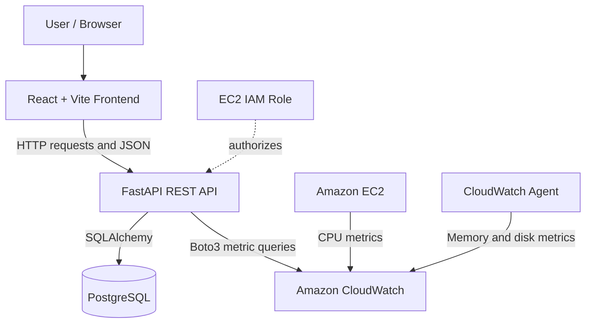

# CloudOps Nexus – System Architecture

## Architecture Overview

CloudOps Nexus combines a React frontend, FastAPI backend, PostgreSQL database, and AWS monitoring services.

## Components

| Component | Responsibility |
|---|---|
| React + Vite | Dashboard interface and API requests |
| FastAPI | REST endpoints and application logic |
| PostgreSQL | Incident record storage |
| SQLAlchemy | Python ORM for database operations |
| Boto3 | AWS API access from Python |
| Amazon EC2 | Compute host for the demonstrated backend |
| Amazon CloudWatch | Monitoring metric storage and retrieval |
| CloudWatch Agent | Operating-system memory and disk metrics |
| EC2 IAM role | AWS permissions for the application |

## Monitoring Data Flow

1. The frontend requests monitoring information from FastAPI.
2. FastAPI creates a Boto3 CloudWatch client.
3. CPU utilization is retrieved from the AWS/EC2 namespace.
4. Memory and disk utilization are retrieved from the CWAgent namespace.
5. FastAPI returns the latest available values and timestamps as JSON.
6. React displays the metrics.

## Incident Data Flow

1. A user submits an incident title and description.
2. React sends a POST request to `/incidents`.
3. FastAPI validates the request.
4. SQLAlchemy stores the incident in PostgreSQL.
5. A GET request to `/incidents` retrieves saved records for display.

## Demonstration Environment

- The React/Vite frontend ran locally during the demonstration.
- The FastAPI backend ran on an EC2 instance.
- PostgreSQL stored incident records. A local PostgreSQL Docker container was used during development; the complete application was not containerized.
- The EC2 API process was started manually and was not configured as a persistent system service.

## Potential Extensions

Docker Compose, GitHub Actions CI/CD, SNS notifications, Cost Explorer reporting, HTTPS, persistent process supervision, and production deployment automation are potential future improvements. They are not part of the current working implementation.

## Engineering Considerations

The AWS region and EC2 instance identifier should be externalized into environment configuration. Production use would also require authentication, automated tests, structured logging, HTTPS, and persistent process supervision.
