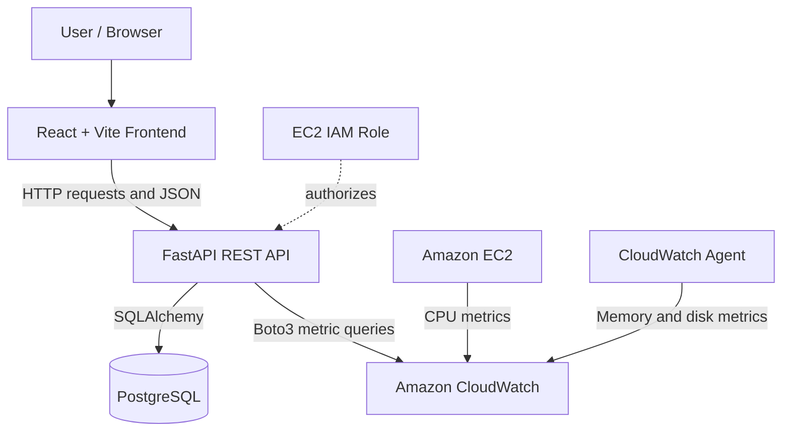

# CloudOps Nexus – System Architecture

## Purpose
This document explains the current application design and separates working components from future extensions.

## Current architecture

## Component responsibilities

| Component | Responsibility |
|---|---|
| React + Vite | Displays the dashboard and calls backend endpoints |
| FastAPI | Provides REST endpoints and handles application logic |
| PostgreSQL | Stores incident records |
| SQLAlchemy | Maps Python models to database tables |
| Boto3 | Calls AWS APIs from Python |
| EC2 | Hosts the demonstrated backend and provides instance metrics |
| CloudWatch | Stores and serves monitoring metrics |
| CloudWatch Agent | Collects operating-system memory and disk metrics |
| IAM role | Grants AWS permissions without hardcoded access keys |

## Monitoring data path
1. The frontend requests the monitoring endpoint.
2. FastAPI creates a Boto3 CloudWatch client.
3. The backend requests EC2 CPU data from the AWS/EC2 namespace.
4. It requests memory and disk data from the CWAgent namespace.
5. FastAPI returns the latest available values and timestamps as JSON.
6. React displays the response.

## Incident data path
1. The user submits an incident title and description.
2. React sends POST /incidents.
3. FastAPI validates the request.
4. SQLAlchemy saves the record in PostgreSQL.
5. GET /incidents retrieves saved records for display.

## Demonstration setup and limitations
- The React/Vite frontend was run locally during the demonstration.
- The FastAPI backend was hosted on an EC2 instance.
- PostgreSQL was used for incident storage. A local PostgreSQL Docker container was used during development; the full application was not containerized.
- The EC2 API process was started manually. It was not configured as a persistent system service or automatic restart process.

## Future design – not implemented
Potential extensions include Docker Compose, GitHub Actions CI/CD, SNS notifications, Cost Explorer reporting, HTTPS, a persistent service manager, and production deployment automation. These are proposals, not current working components.

## Improvements to consider
- Move the AWS region and instance identifier into environment configuration.
- Add automated backend and frontend tests.
- Add authentication and authorization.
- Add structured logging and stronger validation.
- Configure HTTPS and persistent process supervision before production use.
