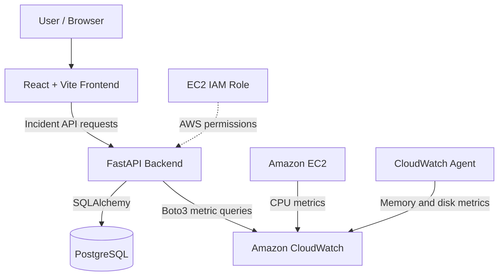

# CloudOps Nexus – System Architecture

## Architecture Overview

CloudOps Nexus contains a React frontend, FastAPI backend, PostgreSQL database, and a backend integration with Amazon CloudWatch.

## Components

| Component | Responsibility |
|---|---|
| React + Vite | Dashboard layout, navigation, theme toggle, and incident requests |
| FastAPI | REST endpoints for health, incidents, and CloudWatch metric retrieval |
| PostgreSQL | Incident record storage |
| SQLAlchemy | Python ORM for database operations |
| Boto3 | AWS API access from Python |
| Amazon EC2 | Demonstrated backend host and monitored instance |
| Amazon CloudWatch | Monitoring metric storage and retrieval |
| CloudWatch Agent | Operating-system memory and disk metrics |
| EC2 IAM role | AWS permissions for the backend host |

## Implemented Data Paths

### Incident management
The React incident page sends requests to the FastAPI incident endpoints. FastAPI uses SQLAlchemy to create and retrieve records in PostgreSQL. The dashboard also requests the incident list to calculate the open incident count.

### CloudWatch API
The FastAPI backend includes a `GET /monitoring` endpoint. It uses Boto3 to query CPU utilization in the AWS/EC2 namespace and memory/disk utilization in the CWAgent namespace. The endpoint returns metric values and timestamps as JSON.

## Frontend Integration Status

The React source currently calls the incident endpoints at `http://127.0.0.1:8000`. The monitoring page displays a placeholder message, and the dashboard CPU, memory, and disk cards display placeholder values. The frontend does not currently call `GET /monitoring`. The cost page is also a placeholder.

Therefore, the backend CloudWatch endpoint is implemented, but the end-to-end metric display in the React interface is not yet complete.

## Demonstration Environment

- React/Vite frontend runs locally during development.
- FastAPI backend was demonstrated on an EC2 instance.
- PostgreSQL stores incident records. A local PostgreSQL Docker container was used during development; the full application stack is not containerized.
- The EC2 API process was started manually and is not configured as a persistent system service.

## Planned Improvements

Connecting React metric cards to the monitoring endpoint, adding a configurable API base URL, implementing Cost Explorer and SNS integrations, full-stack Docker Compose, GitHub Actions CI/CD, authentication, HTTPS, and persistent process supervision are future improvements.
