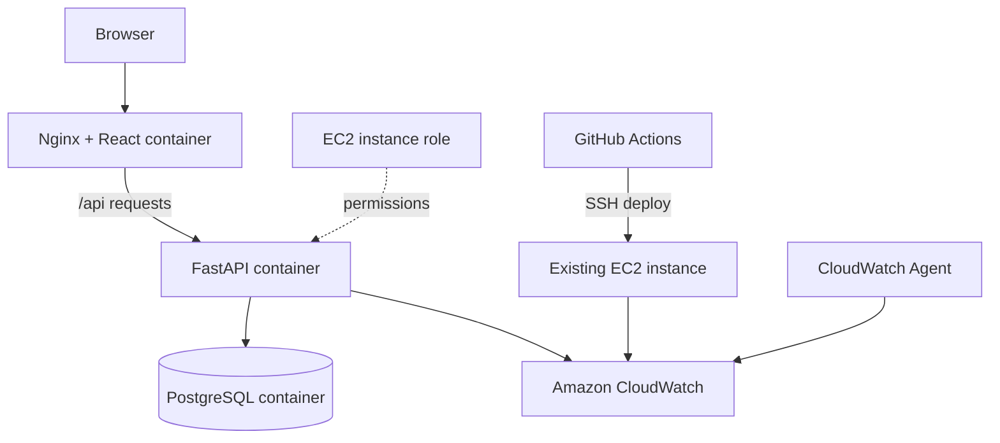

# CloudOps Nexus Architecture

CloudOps Nexus runs on the existing AWS EC2 instance using Docker Compose.

## Containers

| Container | Role |
|---|---|
| Frontend | Serves the React production build using Nginx |
| Backend | Runs FastAPI and the CloudWatch integration |
| Database | Stores incident records in PostgreSQL |

Docker Compose creates a private network for communication between the containers. Only the frontend publishes a host port. Nginx forwards `/api` requests to FastAPI, while the browser loads the React application from the same host.

PostgreSQL uses a named Docker volume so incident data remains when containers are rebuilt.

## Monitoring

FastAPI reads EC2 CPU metrics from the AWS/EC2 CloudWatch namespace and memory/disk metrics from CWAgent. The EC2 instance role supplies AWS permissions to the backend container through the host's instance credentials.

The EC2 instance ID, AWS region, and CloudWatch disk dimensions are set through environment variables.

## Deployment

GitHub Actions checks the backend source, builds the frontend, validates the Compose configuration, and connects to the existing EC2 instance over SSH. It pulls the latest repository changes and runs Docker Compose to rebuild and restart the services.
