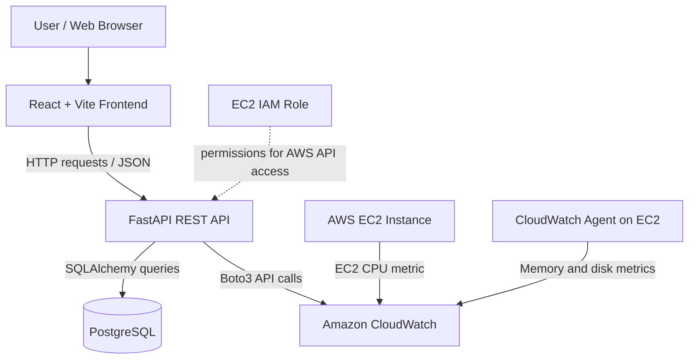

# CloudOps Nexus – Architecture

## 1. Purpose

CloudOps Nexus is a web application for viewing AWS EC2 monitoring information and managing infrastructure incidents from one dashboard.

The current application has three main software layers:

1. **Frontend:** React and Vite dashboard.
2. **Backend:** Python FastAPI REST API.
3. **Database:** PostgreSQL accessed through SQLAlchemy.

The backend also communicates with Amazon CloudWatch through the AWS SDK for Python (Boto3).

## 2. Current architecture

### Request flow

- The user opens the React dashboard in a browser.
- The frontend sends HTTP requests to the FastAPI backend.
- For incident operations, FastAPI reads from or writes to PostgreSQL.
- For server monitoring, FastAPI uses Boto3 to request recent metric data from CloudWatch.
- The frontend displays the JSON response.

## 3. Component responsibilities

| Component | Responsibility |
|---|---|
| React | Dashboard interface and user interaction |
| Vite | Frontend development server and build tool |
| FastAPI | REST API endpoints and request handling |
| SQLAlchemy | Python object-relational mapping and database access |
| PostgreSQL | Stores incident records |
| Amazon EC2 | Hosts the demonstrated backend environment |
| Amazon CloudWatch | Stores and provides monitoring metrics |
| CloudWatch Agent | Sends guest operating system memory and disk metrics |
| IAM role | Gives the EC2 workload permission to call required AWS APIs |
| Boto3 | Python SDK used by the backend to call CloudWatch |

## 4. Monitoring metrics

- **CPU utilization:** Read from the `AWS/EC2` CloudWatch namespace.
- **Memory utilization:** Read from the `CWAgent` namespace.
- **Disk utilization:** Read from the `CWAgent` namespace.

The backend queries a recent time window and returns the latest available datapoint. A metric may be unavailable if CloudWatch has not received a datapoint or the metric dimensions do not match.

## 5. Current demonstration topology

The demonstrated setup used the React/Vite frontend on a development computer and the FastAPI backend on an EC2 instance. PostgreSQL was used for incident storage. The backend process was started manually for the demonstration; it was not configured as a production-grade persistent service.

Local development also used a PostgreSQL Docker container. This does **not** mean the complete application has been containerized.

## 6. Proposed future architecture (not implemented)

The following are possible extensions, not completed features:

- Docker images for the frontend and backend.
- Docker Compose to run the application and database together.
- GitHub Actions for automated linting, testing, building, and deployment.
- Amazon SNS for email notifications.
- AWS Cost Explorer for cost and usage reporting.
- A persistent service manager, HTTPS, secrets management, and production deployment hardening.

These future components are intentionally shown separately from the current architecture so the repository does not overstate implementation status.
