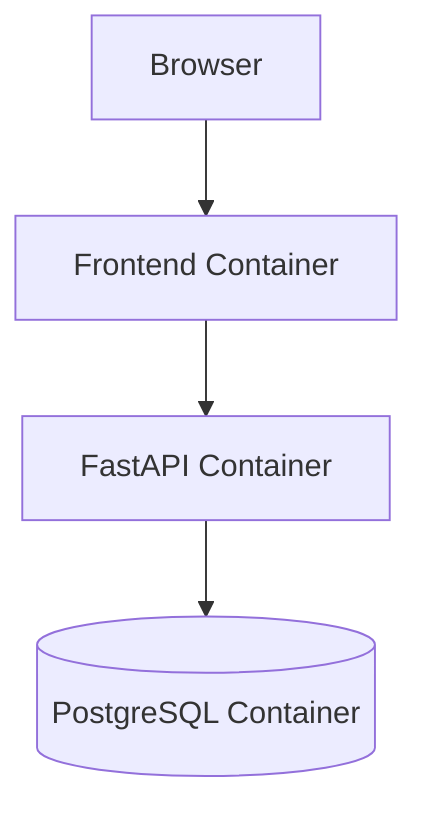
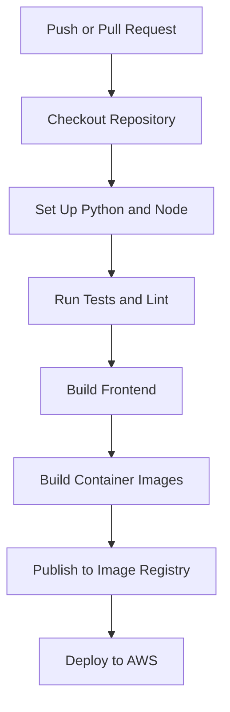

# Docker and GitHub Actions – Future Design

> **Status: Planned.** The complete CloudOps Nexus application is not currently containerized, and a GitHub Actions CI/CD workflow has not been implemented. This document describes a possible future design only.

## Docker
Docker packages an application and its dependencies into an image. A container is a running instance of an image.

A future setup could run:
- React/Vite frontend container.
- FastAPI backend container.
- PostgreSQL container for local development.

## Proposed Docker Compose layout

Docker Compose could define these services in one YAML file, provide environment variables, and use a named volume for database persistence.

A PostgreSQL container was used locally during development. This does not mean the entire frontend/backend/database stack has already been containerized.

## GitHub Actions – proposed CI/CD

Possible stages:
1. Check out the repository.
2. Install Python and Node.js dependencies.
3. Run backend tests and frontend lint/build checks.
4. Build Docker images.
5. Publish images to a registry.
6. Deploy to AWS after required approvals.

## Security
Do not put AWS keys or database passwords in workflow files. Use GitHub Actions secrets or AWS OIDC with a narrowly scoped IAM role.

## Interview explanation
"Docker and GitHub Actions are planned improvements. I documented how I would containerize the application services and automate tests, builds, image publishing, and deployment. These workflows are not implemented in the current version."
