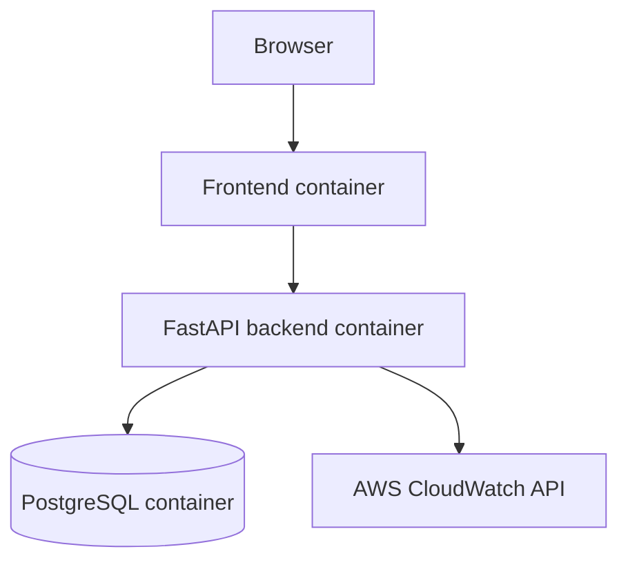
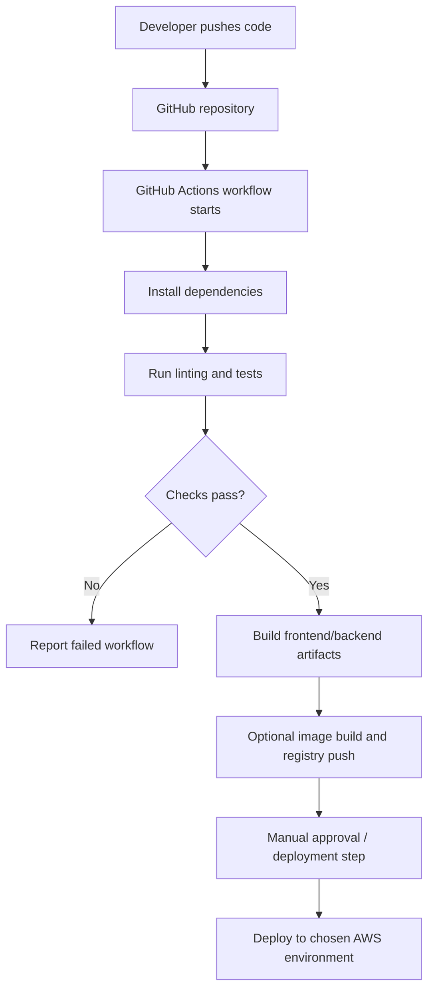

# Proposed Docker and GitHub Actions Design

> **Status: Planned design only.** The complete CloudOps Nexus application has not been containerized, and a GitHub Actions deployment pipeline has not been implemented. This document explains how these technologies could be added later; it is not evidence that the pipeline currently exists.

## 1. Why Docker could be useful

Docker packages an application and its dependencies into a container image. This can make the same application environment easier to run on a developer computer, a test server, or a cloud host.

Possible containers:

- **Frontend container:** React/Vite application served using a production web server.
- **Backend container:** FastAPI application and its Python dependencies.
- **Database container:** PostgreSQL for local development or testing.

A future Docker Compose file could define the services, their network, environment variables, and persistent database volume.

## 2. Proposed container architecture

The diagram is a proposed design. The current project has used Docker for a local PostgreSQL database, but the complete frontend/backend/database stack is not currently deployed through Docker Compose.

## 3. Why GitHub Actions could be useful

GitHub Actions is a CI/CD automation service integrated with GitHub.

- **Continuous Integration (CI):** automatically run checks when code is pushed or a pull request is opened.
- **Continuous Delivery/Deployment (CD):** prepare or deploy a validated application release.

## 4. Proposed CI/CD workflow

## 5. Suggested implementation order for a future version

1. Add backend dependency and test configuration.
2. Create and test a backend Dockerfile.
3. Create a production frontend Dockerfile.
4. Add a Docker Compose configuration for local development.
5. Add health checks and persistent database storage.
6. Create GitHub Actions CI for linting, tests, and builds.
7. Add deployment only after CI is reliable.
8. Store deployment credentials in GitHub Actions secrets or use AWS OIDC; never hardcode credentials.

## 6. Interview explanation

A suitable honest explanation is:

" Docker and GitHub Actions are planned improvements for CloudOps Nexus. Docker would package the frontend and backend consistently, while Docker Compose could run the application services together for development. GitHub Actions could automate code checks and builds on every push. I documented the proposed design, but I have not implemented the full containerization or CI/CD pipeline yet."

Do not describe these planned features as completed project functionality.
