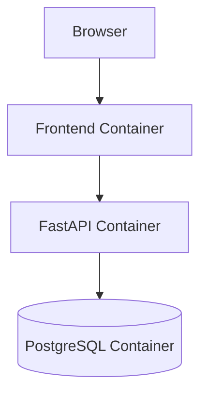
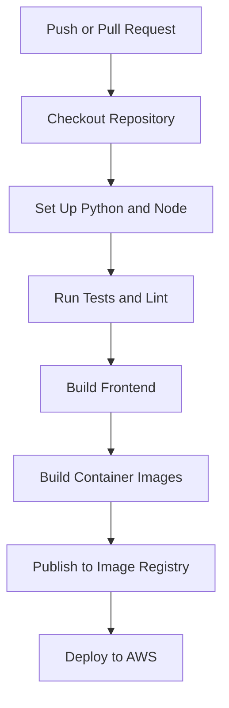

# Docker and GitHub Actions – Future Enhancements

Docker and GitHub Actions are not implemented in the current CloudOps Nexus application. The following sections describe how they could extend the project.

## Docker

Docker packages an application and its dependencies into an image. A container is a running instance of an image.

A containerized version of CloudOps Nexus could separate the application into:
- A React/Vite frontend container.
- A FastAPI backend container.
- A PostgreSQL container for local development.

## Proposed Docker Compose Architecture

Docker Compose could define the services in one YAML file, configure their environment variables, and provide persistent database storage through a named volume.

A PostgreSQL container was used during local development. The frontend, backend, and database have not been packaged together as a complete Docker Compose application.

## GitHub Actions CI/CD

GitHub Actions could automate quality checks and deployment when code is pushed or a pull request is opened.

A future pipeline could:
1. Check out the repository.
2. Install Python and Node.js dependencies.
3. Run backend tests and frontend checks.
4. Build Docker images.
5. Publish images to a container registry.
6. Deploy to AWS after required approvals.

## Security

Workflow secrets should not be stored in repository files. GitHub Actions secrets or AWS OIDC with a narrowly scoped IAM role can be used for deployment credentials.

## Interview Summary

Docker and GitHub Actions are planned improvements. The proposed design separates application services into containers and automates testing, building, image publishing, and deployment. No working CI/CD pipeline is included in this version.
