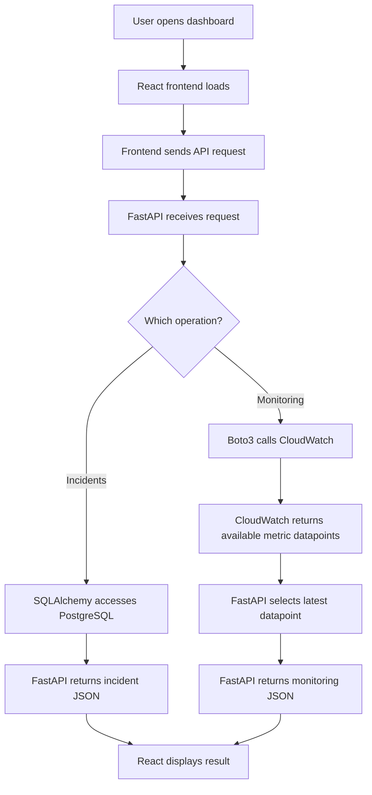

# CloudOps Nexus – Application Workflow

This document explains what happens when a user works with the current application.

## 1. Main application flow

## 2. Incident creation workflow

1. The user enters an incident title and description in the frontend.
2. React sends a `POST /incidents` request with JSON data.
3. FastAPI validates the request using a Pydantic model.
4. FastAPI creates an incident database object.
5. SQLAlchemy writes the record to PostgreSQL.
6. The API returns the created incident.
7. The frontend can request `GET /incidents` to refresh the incident list.

The incident model includes an ID, title, description, status (default: Open), and creation timestamp.

## 3. Incident listing workflow

1. React requests `GET /incidents`.
2. FastAPI opens a database session.
3. SQLAlchemy queries the incidents table.
4. FastAPI returns the records as JSON.
5. React displays the returned incidents.

## 4. Server monitoring workflow

1. React requests `GET /monitoring`.
2. FastAPI creates a Boto3 CloudWatch client in the configured AWS region.
3. Boto3 uses the AWS credentials available to the backend environment. In the EC2 demonstration, this was an EC2 IAM role.
4. The backend requests CPU, memory, and disk metrics.
5. CloudWatch returns datapoints for the requested time range.
6. The backend selects the newest datapoint for each metric.
7. FastAPI returns the values and timestamps as JSON.
8. React displays the monitoring information.

### Metric sources

| Metric | CloudWatch namespace | Metric name |
|---|---|---|
| CPU | `AWS/EC2` | `CPUUtilization` |
| Memory | `CWAgent` | `mem_used_percent` |
| Disk | `CWAgent` | `disk_used_percent` |

CPU metrics are provided by EC2 monitoring. Memory and disk metrics require the CloudWatch Agent to be installed and configured on the instance.

## 5. API endpoint summary

| Method | Endpoint | Purpose |
|---|---|---|
| GET | `/` | Basic API welcome/status response |
| GET | `/health` | Health response |
| GET | `/monitoring` | Retrieve recent CloudWatch metrics |
| POST | `/incidents` | Create an incident |
| GET | `/incidents` | List incidents |

## 6. Error and availability notes

- If CloudWatch has no datapoints for the requested period, the API returns a null metric value and timestamp for that metric.
- If the CloudWatch request fails, the monitoring endpoint returns an HTTP 503 response.
- The API requires a valid database connection for incident endpoints.
- The frontend and backend must be configured with matching API and CORS settings.

## 7. Current scope

The workflows above describe the endpoints present in the repository. Automated SNS notifications, Cost Explorer reporting, incident update/delete operations, and automated deployment are future enhancements unless separately implemented and verified.
