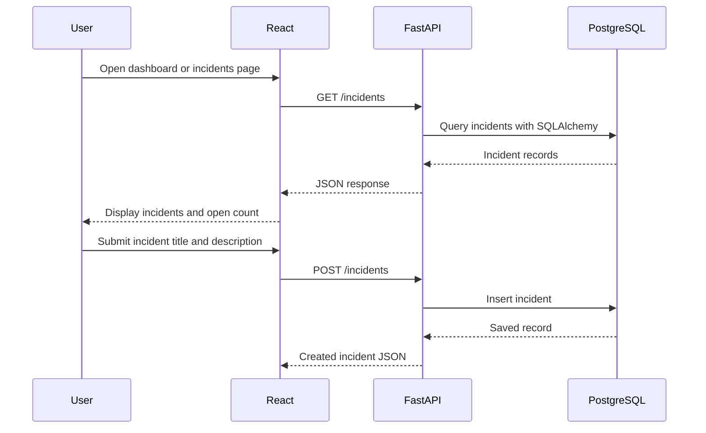
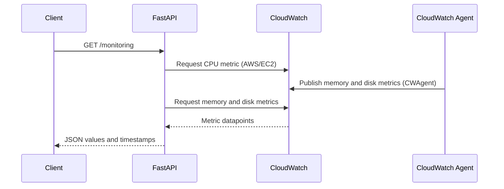

# CloudOps Nexus – Application Workflow

## Application Startup

1. PostgreSQL is started and the application database is configured.
2. The backend reads `DATABASE_URL` from environment configuration.
3. FastAPI connects to PostgreSQL through SQLAlchemy.
4. The React/Vite development server starts separately.
5. The browser loads the dashboard.

## Incident Management Workflow

## CloudWatch Monitoring API Workflow

The backend monitoring endpoint is implemented. The current React frontend does not call this endpoint; its monitoring screen and dashboard metric cards remain placeholders.

| Metric | CloudWatch Namespace | Source |
|---|---|---|
| CPUUtilization | AWS/EC2 | EC2 monitoring |
| mem_used_percent | CWAgent | CloudWatch Agent |
| disk_used_percent | CWAgent | CloudWatch Agent |

## API Endpoints

| Method | Endpoint | Purpose |
|---|---|---|
| GET | `/` | Basic application response |
| GET | `/health` | Health status |
| GET | `/monitoring` | CloudWatch CPU, memory, and disk metrics |
| POST | `/incidents` | Create an incident |
| GET | `/incidents` | List incidents |

## Operational Notes

The backend requires a valid `DATABASE_URL` and AWS permissions to read CloudWatch metrics. The CloudWatch Agent must publish memory and disk metrics. Metric publication can be delayed.

The frontend incident API URL is currently hardcoded to `http://127.0.0.1:8000`. The backend API process in the demonstration was started manually and is not configured for automatic restart.

## Future Capabilities

Frontend metric integration, Cost Explorer reporting, SNS notifications, incident updates/resolution, automated tests, Docker Compose, and CI/CD deployment are future improvements.
