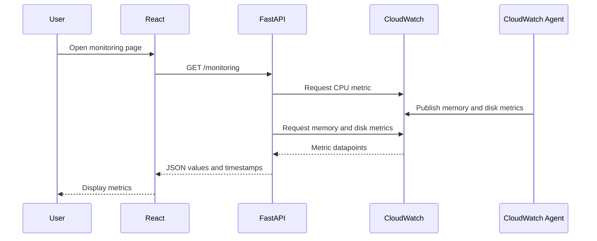
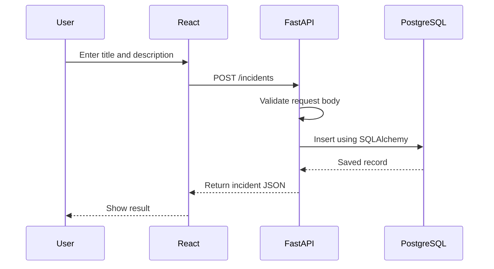

# CloudOps Nexus – Application Workflow

## 1. Application startup
1. Start PostgreSQL and create the application database.
2. Configure DATABASE_URL in a local .env file using .env.example as a template.
3. Start the FastAPI backend.
4. Start the React/Vite development server separately.
5. Open the Vite URL in a browser.

## 2. Monitoring workflow

| Metric | Namespace | Source |
|---|---|---|
| CPUUtilization | AWS/EC2 | EC2 monitoring |
| mem_used_percent | CWAgent | CloudWatch Agent |
| disk_used_percent | CWAgent | CloudWatch Agent |

The backend requests recent datapoints and selects the newest timestamp. If no datapoint exists, the metric value and timestamp are returned as null.

## 3. Create incident workflow

## 4. List incidents
1. React requests GET /incidents.
2. FastAPI opens a database session.
3. SQLAlchemy queries the incidents table.
4. FastAPI returns records as JSON.
5. React renders the list.

## 5. API endpoints

| Method | Endpoint | Purpose |
|---|---|---|
| GET | / | Basic application response |
| GET | /health | Health status |
| GET | /monitoring | CloudWatch CPU, memory, and disk metrics |
| POST | /incidents | Create an incident |
| GET | /incidents | List incidents |

## 6. Operational considerations
- DATABASE_URL must be configured before backend startup.
- The backend needs AWS permissions to read CloudWatch metrics.
- CloudWatch Agent must be running and publishing guest OS metrics.
- Metrics can be delayed or temporarily unavailable.
- The demonstrated API process was started manually and does not automatically restart after a reboot.

## 7. Future workflows – not implemented
SNS notifications, Cost Explorer reporting, incident update/assignment/resolution endpoints, automated tests, container builds, and CI/CD deployment are future enhancements.
