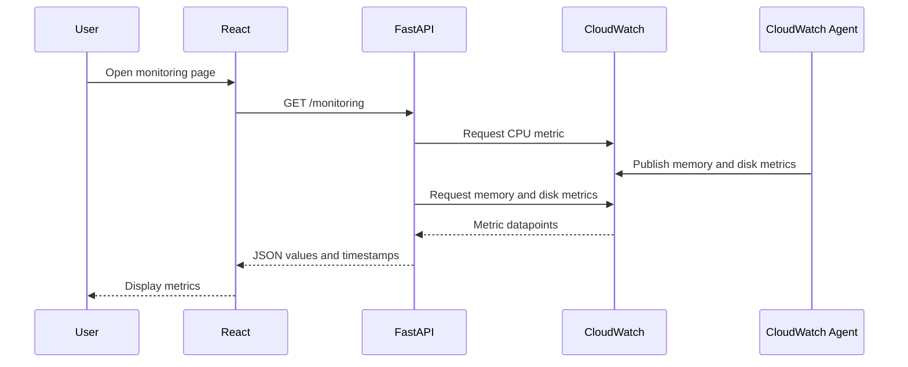
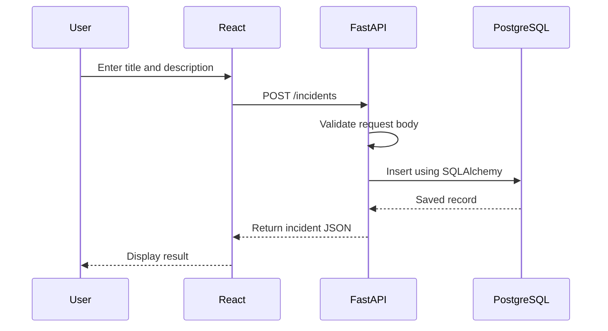

# CloudOps Nexus – Application Workflow

## Application Startup

The application consists of two separately started parts: the FastAPI backend and the React/Vite frontend. PostgreSQL must be available before the backend can use incident storage.

1. PostgreSQL is started and the application database is configured.
2. The backend reads its database connection string from environment configuration.
3. FastAPI starts and connects to PostgreSQL through SQLAlchemy.
4. The React/Vite development server starts separately.
5. The browser loads the dashboard.

## Infrastructure Monitoring

| Metric | CloudWatch Namespace | Source |
|---|---|---|
| CPUUtilization | AWS/EC2 | EC2 monitoring |
| mem_used_percent | CWAgent | CloudWatch Agent |
| disk_used_percent | CWAgent | CloudWatch Agent |

The backend requests recent datapoints and selects the newest timestamp. If no datapoint is available, the metric value and timestamp are returned as null.

## Incident Creation

## Incident Listing

1. React requests `GET /incidents`.
2. FastAPI opens a database session.
3. SQLAlchemy queries the incidents table.
4. FastAPI returns the records as JSON.
5. React renders the incident list.

## API Endpoints

| Method | Endpoint | Purpose |
|---|---|---|
| GET | `/` | Basic application response |
| GET | `/health` | Health status |
| GET | `/monitoring` | CloudWatch CPU, memory, and disk metrics |
| POST | `/incidents` | Create an incident |
| GET | `/incidents` | List incidents |

## Operational Notes

The backend requires a valid `DATABASE_URL` and AWS permissions to read CloudWatch metrics. The CloudWatch Agent must be running and publishing memory and disk metrics. Metric publication can be delayed, and datapoints may temporarily be unavailable.

The demonstration API process was started manually. Automatic restart after a reboot or persistent process supervision is not configured.

## Future Capabilities

Incident updates and resolution, SNS notifications, Cost Explorer reporting, automated tests, container builds, and CI/CD deployment are not included in the current implementation.
